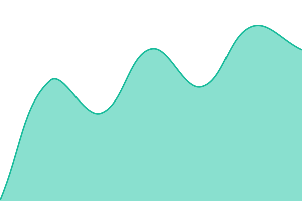
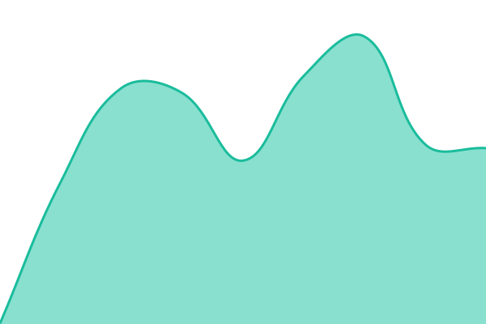
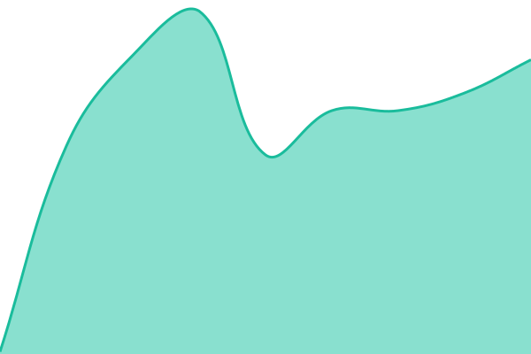

# [📈 Live Status](https://status.theprototype.app): <!--live status--> **🟩 All systems operational**

This repository contains the open-source uptime monitor and status page for [The Prototype](https://theprototype.app), powered by [Upptime](https://github.com/upptime/upptime).

With [Upptime](https://upptime.js.org), you can get your own unlimited and free uptime monitor and status page, powered entirely by a GitHub repository. We use [Issues](https://github.com/theprototype-app/status/issues) as incident reports, [Actions](https://github.com/theprototype-app/status/actions) as uptime monitors, and [Pages](https://status.theprototype.app) for the status page.

<!--start: status pages-->
<!-- This summary is generated by Upptime (https://github.com/upptime/upptime) -->
<!-- Do not edit this manually, your changes will be overwritten -->
<!-- prettier-ignore -->
| URL | Status | History | Response Time | Uptime |
| --- | ------ | ------- | ------------- | ------ |
|  [App](https://theprototype.app/version.json) | 🟩 Up | [app.yml](https://github.com/theprototype-app/status/commits/HEAD/history/app.yml) | 

 0ms
     
 | 

<a href="https://status.theprototype.app/history/app">100.00%</a>
    

|  [Accounts, saves and community data (PocketBase)](https://pb.theprototype.app/api/health) | 🟩 Up | [accounts-saves-and-community-data-pocket-base.yml](https://github.com/theprototype-app/status/commits/HEAD/history/accounts-saves-and-community-data-pocket-base.yml) | 

 0ms
     
 | 

<a href="https://status.theprototype.app/history/accounts-saves-and-community-data-pocket-base">100.00%</a>
    

|  [Connecting people (signaling)](https://peerjs.theprototype.app/peerjs) | 🟩 Up | [connecting-people-signaling.yml](https://github.com/theprototype-app/status/commits/HEAD/history/connecting-people-signaling.yml) | 

 0ms
     
 | 

<a href="https://status.theprototype.app/history/connecting-people-signaling">100.00%</a>
    

|  [Alert test (48-ops, removed after)](https://theprototype.pages.dev/version.json) | 🟩 Up | [alert-test-48-ops-removed-after.yml](https://github.com/theprototype-app/status/commits/HEAD/history/alert-test-48-ops-removed-after.yml) | 

 0ms
     
 | 

<a href="https://status.theprototype.app/history/alert-test-48-ops-removed-after">10.68%</a>
    

|  [Relay for hard networks (TURN)](peerjs.theprototype.app) | 🟩 Up | [relay-for-hard-networks-turn.yml](https://github.com/theprototype-app/status/commits/HEAD/history/relay-for-hard-networks-turn.yml) | 

 0ms
     
 | 

<a href="https://status.theprototype.app/history/relay-for-hard-networks-turn">100.00%</a>
    

<!--end: status pages-->

[**Visit our status website →**](https://status.theprototype.app)

## 📄 License

- Powered by: [Upptime](https://github.com/upptime/upptime)
- Code: [MIT](./LICENSE) © [Anand Chowdhary](https://anandchowdhary.com)
- Data in the `./history` directory: [Open Database License](https://opendatacommons.org/licenses/odbl/1-0/)
